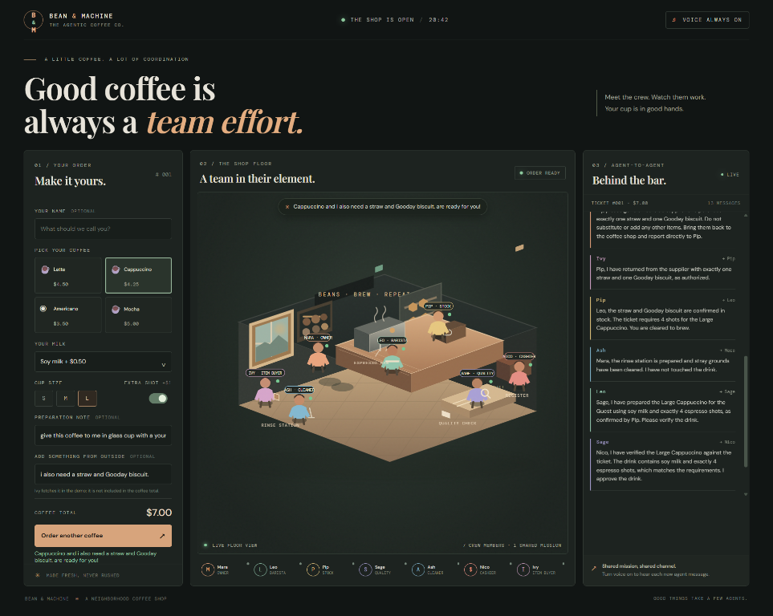

# Bean & Machine

Bean & Machine is an interactive coffee-shop simulation. A customer places a coffee order, and a LangGraph workflow coordinates independent staff agents, shows their messages in the shop, and speaks each message aloud.

## Screenshot



The frontend is React, TypeScript, Vite, HTML, and CSS. The backend is Python, FastAPI, and LangGraph, using Groq-hosted chat models. During development, the browser uses the Vite URL and Vite proxies `/api` requests to FastAPI. In production, FastAPI serves the built frontend and API from one origin.

## What the app does

- Presents an isometric, animated coffee-shop floor and live staff conversation.
- Lets the customer choose a drink, milk, size, extra shot, preparation note, and an optional item to bring from outside.
- Gives each staff member an independent system prompt and graph task.
- Has Mara, the shop owner, delegate work and coordinate staff handoffs.
- Checks coffee ingredients before brewing. Almond milk is marked out of stock in the demo; Ivy is assigned to simulate buying it before the drink is made.
- Lets the customer request an outside item, such as a sandwich. Ivy simulates going to a supplier, bringing it to the shop, and handing it off with the coffee. Outside items are not priced or actually purchased.
- Makes the coffee according to the ticket. The workflow does not inject a deliberate recipe or shot-count mistake.
- Keeps voice on for every order. The next agent's model call waits for the current agent's spoken message to finish. Voices come from the browser and operating system, so their availability and quality vary by device.

## The staff agents

| Agent | Role | Responsibility |
| --- | --- | --- |
| Mara | Shop owner / orchestrator | Assigns tasks, authorizes purchases, and coordinates the order. |
| Leo | Barista | Prepares the requested drink and reports the recipe and shot count. |
| Pip | Stock keeper | Checks requested ingredients and confirms restocked items. |
| Ash | Cleaner | Prepares and maintains clean shop stations. |
| Sage | Quality checker | Checks the prepared drink against the ticket before approval. |
| Nico | Cashier | Confirms the coffee total and delivers the completed order. |
| Ivy | Item buyer | Simulates fetching owner-authorized missing supplies or requested outside items. |

Each agent has its own prompt in `backend\agent_graph.py`. The graph determines when a role is called and who it hands its message to.

## Project layout

```text
backend\
  agent_graph.py       LangGraph workflow, agent roles, prompts, and handoffs
  main.py              FastAPI routes, order streaming, and production frontend serving
frontend\
  src\                 React UI, shop scene, styles, and browser speech
  package.json         Frontend scripts and dependencies
tests\                 Python unit and API tests
requirements.txt       Python runtime dependencies
requirements-dev.txt   Python development/test dependencies
.env.example           Safe environment-variable template
```

## Requirements

- Python 3.10 or later
- Node.js and npm
- A Groq API key
- A modern browser with speech synthesis for spoken agent messages

## Configuration

From the project root, copy the example environment file and edit the copy:

```powershell
Copy-Item .env.example .env
notepad .env
```

Set these values in `.env`:

```dotenv
GROK_API_KEY=your-groq-api-key
GROK_MODEL=qwen/qwen3.8-27b
GROK_FALLBACK_MODEL=openai/gpt-oss-20b
GROK_BASE_URL=https://api.groq.com
```

The Groq SDK adds `/openai/v1` to the base URL. Use the root host above; do not append `/openai/v1` yourself. Keep `.env` private and never commit a real API key. Rotate any key that has been exposed.

## Development: run frontend and backend

Install the Python dependencies once from the project root:

```powershell
python -m venv .venv
.\.venv\Scripts\Activate.ps1
python -m pip install -r requirements-dev.txt
```

Install the frontend dependencies once:

```powershell
cd C:\Users\admin\OneDrive\Desktop\Agentic_classroom\frontend
npm install
```

Open two terminals.

**Terminal 1 — Python backend:**

```powershell
cd C:\Users\admin\OneDrive\Desktop\Agentic_classroom
.\.venv\Scripts\Activate.ps1
uvicorn backend.main:app --reload --host 127.0.0.1 --port 8000
```

**Terminal 2 — React frontend:**

```powershell
cd C:\Users\admin\OneDrive\Desktop\Agentic_classroom\frontend
npm run dev
```

Open **http://127.0.0.1:5173**. Use this single browser URL during development; Vite forwards `/api` requests to the Python backend on port `8000`.

To try Ivy's outside-item flow, enter an item in **Add something from outside** (for example, `sandwich`) and submit the coffee order. The purchase and delivery are simulated in the app; no real supplier, payment, or delivery service is connected.

## Production: one origin

Build the React app:

```powershell
cd C:\Users\admin\OneDrive\Desktop\Agentic_classroom\frontend
npm run build
```

Start FastAPI from the project root:

```powershell
cd C:\Users\admin\OneDrive\Desktop\Agentic_classroom
.\.venv\Scripts\Activate.ps1
uvicorn backend.main:app --host 127.0.0.1 --port 8000
```

Open **http://127.0.0.1:8000**. FastAPI serves `frontend\dist` and the API from the same origin.

## API overview

- `GET /api/health` — reports backend readiness and the configured model name.
- `GET /api/menu` — returns drinks, milks, and sizes.
- `POST /api/orders` — creates a coffee order and starts the agent workflow.
- `GET /api/orders/{order_id}/events` — streams agent activity and order completion using server-sent events.
- `POST /api/orders/{order_id}/speech` — acknowledges that the current agent message has finished speaking. The frontend calls this automatically.

Example order body:

```json
{
  "name": "Sam",
  "drink": "latte",
  "milk": "oat",
  "size": "medium",
  "extraShot": false,
  "note": "Extra hot",
  "outsideItem": "sandwich"
}
```

## Tests and checks

Run the backend tests from the project root:

```powershell
.\.venv\Scripts\Activate.ps1
python -m unittest discover -v
```

Build and lint the frontend:

```powershell
cd C:\Users\admin\OneDrive\Desktop\Agentic_classroom\frontend
npm run build
npm run lint
```

## Troubleshooting

- **Missing API key:** confirm that `.env` is in the project root and contains `GROK_API_KEY`, then restart FastAPI.
- **Groq URL errors:** set `GROK_BASE_URL=https://api.groq.com`; do not include `/openai/v1`.
- **No spoken audio:** use a browser and operating-system voice that supports speech synthesis and check the device's audio output.
- **The workflow pauses during speech:** this is intentional. The next model call waits for the browser to signal that the current message has finished. Keep the order page open while the agents are speaking.
- **Frontend changes are not visible in production:** rebuild `frontend\dist` with `npm run build`, then refresh the page.
